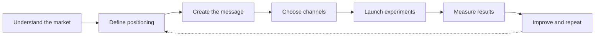

<div align="center">

<a href="https://github.com/NISTALTALSON/marketing-skills">
  
</a>

<p>
  
  
  
  
</p>

<p>
  <strong>Reusable marketing intelligence for AI agents and modern product teams.</strong><br />
  Turn a blank page, an untested idea, or a stalled growth channel into a clear next action.
</p>

<p>
  <a href="#-what-is-included">Explore the skills</a> ·
  <a href="#-quick-start">Quick start</a> ·
  <a href="#-using-a-skill">Use a skill</a> ·
  <a href="#-contributing">Contribute</a>
</p>

</div>

---

## ✦ What this is

**Marketing Skills** is a structured library of reusable instructions for marketing, growth, and startup execution. Each skill gives an AI agent a focused role, a practical workflow, and a clear output standard so that strategy becomes execution instead of generic advice.

Use it to shape positioning, validate opportunities, create campaigns, improve discoverability, build content systems, launch products, and measure what is working.

## ✨ What is included

The [`skills/`](skills/) directory contains focused playbooks for:

| Area | Typical outcomes |
| --- | --- |
| **Brand & positioning** | Brand foundations, voice, messaging, differentiation, and market context |
| **Content & copywriting** | Landing pages, blogs, editorial systems, hooks, emails, and conversion copy |
| **SEO & discoverability** | Technical audits, keyword strategy, content optimization, programmatic SEO, and AI search visibility |
| **Social & community** | Social content, publishing workflows, community growth, and audience development |
| **Growth & experimentation** | Growth loops, conversion optimization, analytics, attribution, and experiment design |
| **Campaigns & advertising** | Campaign planning, creative direction, paid acquisition, and performance review |
| **Launch & go-to-market** | Launch planning, Product Hunt preparation, release messaging, and channel strategy |
| **Startup & founder operations** | Market opportunity, business cases, financial planning, startup metrics, and founder decision support |
| **Sales & customer development** | Customer research, cold outreach, CRM workflows, sales enablement, and retention |

Browse the folders directly to find a skill by name, or search the repository for a specific problem:

```text
skills/seo/
skills/content-strategy/
skills/marketing-campaign/
skills/launch-strategy/
skills/startup-analyst/
```

> **Tip:** Start with the narrowest skill that matches the job. Compose several skills only when the task genuinely crosses disciplines.

## ⚡ Quick start

### 1. Install the skills

Clone the repository and copy the `skills` directory into the agent-skills location supported by your tool:

```bash
git clone https://github.com/NISTALTALSON/marketing-skills.git
cp -R marketing-skills/skills .agents/skills/
```

For a global installation:

```bash
cp -R marketing-skills/skills ~/.agents/skills/
```

You can also copy a single skill when you want a smaller setup:

```bash
cp -R marketing-skills/skills/seo .agents/skills/
```

### 2. Open your project

Give the agent the product context it needs: what you are building, who it serves, the market, the current stage, and the result you want.

### 3. Load the relevant skill

Use the skill name in a prompt or the slash-command mechanism supported by your agent.

## 🤖 Using a skill

### In a conversation

```text
@skill:content-strategy Build a 30-day content system for a developer tool.
```

```text
@skill:seo Audit the landing page for technical SEO, search intent, and AI-search visibility.
```

```text
@skill:launch-strategy Create a channel-by-channel launch plan with owners, timing, and success metrics.
```

### With a slash command

```text
/skill seo Audit this page and return prioritized fixes with implementation examples.
```

### With a focused task brief

```text
Use the marketing-campaign skill.

Product: An AI assistant for independent retailers
Audience: Retail owners with small teams
Goal: Generate qualified beta signups
Constraints: $500 test budget, 14-day campaign, founder-led execution
Output: Campaign angle, channel plan, creative briefs, measurement plan, and risks
```

### Chaining skills deliberately

For a complete launch, run the work in stages instead of asking for everything at once:

```text
1. @skill:product-marketing-context Define the audience, problem, and differentiated positioning.
2. @skill:copywriting Turn the positioning into landing-page and announcement copy.
3. @skill:content-strategy Build the supporting content calendar.
4. @skill:launch-strategy Turn the assets into a launch sequence with milestones.
5. @skill:analytics Define the measurement plan and feedback loop.
```

## 🧭 A practical workflow



1. **Frame the problem** — clarify the audience, job-to-be-done, constraints, and business goal.
2. **Choose the specialist** — select the skill that best matches the current decision.
3. **Request an artifact** — ask for a plan, brief, audit, draft, experiment, or measurement framework.
4. **Add evidence** — provide customer language, analytics, competitors, screenshots, or existing copy.
5. **Review and iterate** — treat the first output as a working draft and improve it with real feedback.

## 🧩 Skill structure

A skill is designed to be readable by both humans and agents. Most skills include:

```text
skill-name/
└── SKILL.md       # Instructions, workflow, constraints, and output guidance
```

Skills are intentionally modular. They can be used independently, combined into a workflow, or adapted to a product's specific context.

## 🛠️ Compatibility

The collection follows the open Agent Skills convention and is designed to work with tools that support `SKILL.md` instructions, including compatible coding agents, IDE assistants, and CLI-based agent runtimes.

The exact activation syntax varies by tool. If `@skill:name` or `/skill name` is not recognized, open the relevant `SKILL.md` and paste its instructions into your agent prompt.

## 🔐 Responsible use

Marketing outputs should be truthful, evidence-based, and respectful of user privacy. Review generated claims, targeting assumptions, statistics, and customer-facing copy before publishing. Do not use these skills to create deceptive campaigns, spam, impersonation, or unlawful profiling.

## 🤝 Contributing

Contributions are welcome when they make a skill more useful in real work.

1. Add or improve a focused skill under [`skills/`](skills/).
2. Keep the instructions actionable, specific, and easy to scan.
3. Include clear inputs, a repeatable workflow, constraints, and an expected output format.
4. Avoid vendor-specific assumptions unless the skill is explicitly platform-specific.
5. Open a pull request describing the problem the change solves and how it was tested.

## 📄 License

Unless a subdirectory states otherwise, the original skill content in this repository is provided under the [MIT License](LICENSE). Review individual skill files for any additional attribution or licensing requirements before redistributing or publishing derived work.

---

<div align="center">
  <sub>Built for focused thinking, better experiments, and more consistent execution.</sub>
</div>
